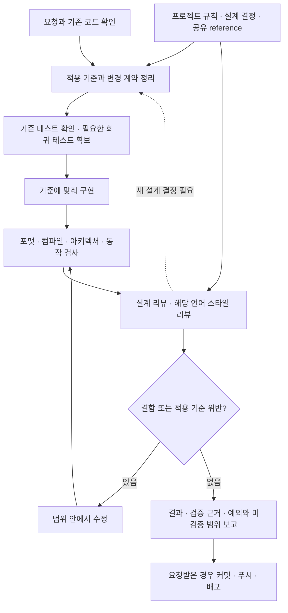

# Spring 구현·리뷰 전체 흐름

`spring-workflow`가 Java·Kotlin·혼용 Spring 프로젝트의 구현과 리뷰를 연결합니다. 개발과 리뷰는 같은 기준 원문을 읽으며, 프로젝트별 설계 선택을 우선합니다.

이 흐름은 구현 요청을 기준으로 합니다. 리뷰만 요청하면 기준 확인과 검사·리뷰부터 시작하고, 수정 권한이 없다면 발견 사항을 보고합니다. 기존 요청으로 결정된 사항을 다시 승인받거나, 작은 변경마다 별도 계획 문서를 만들지는 않습니다.

## 단계별 역할

| 단계 | 담당 스킬·수단 | 확인할 결과 |
| --- | --- | --- |
| 기준과 변경 계약 | `spring-workflow` | 구현할 동작, 소유 모듈·유스케이스, 적용 규칙과 출처, 보존할 동작, 검증 방법 |
| 테스트 확보·구현 | `spring-workflow` | 기존 프로젝트 구조에 맞는 코드와 필요한 동작·회귀 테스트 |
| 자동 검사 | 프로젝트에 구성된 명령 | 실제 검사 범위와 결과. 예: Spotless, 컴파일, Modulith, ArchUnit, 단위·통합 테스트 |
| 설계·계약 리뷰 | `spring-design-review` | 합의한 책임·공개 계약·의존 방향의 준수와 런타임 동작 결함 |
| Java 표현 리뷰 | `java-code-style-review` | Java 명명·메서드 구성·타입·가독성 |
| Kotlin 표현 리뷰 | `kotlin-code-style-review` | Kotlin 명명·제어 흐름·타입·상호 운용성 |
| 기존 운영 흐름 확장 리뷰 | 필요할 때 `legacy-feature-extension-review` | 기존 경로 보존, 새 상태·분기, 트랜잭션·외부 부수 효과 |
| 수정·완료 확인 | `spring-workflow` | 발견 사항 처리, 변경에 영향받는 검사 재실행, 남은 예외·위험 보고 |

각 역할이 별도 에이전트를 뜻하지는 않습니다. 변경에 필요한 리뷰만 수행하며, 같은 코드 상태에서 이미 확인한 검사 결과는 재사용합니다.

## 기준의 원본

| 기준 | 원본 | 개발·리뷰에서의 사용 |
| --- | --- | --- |
| 작업 범위와 동작 | 사용자 요청·기존 계획·인수 조건 | 무엇을 구현하고 어떤 동작을 보존해야 하는지 판단 |
| 프로젝트 설계 선택 | 프로젝트 `AGENTS.md`, 설계 문서·ADR | 모듈 구조, 공개 범위, 컨트롤러 구성 등 해당 프로젝트의 선택 적용 |
| 공통 Spring 설계 | [spring-framework-rules.md](spring-framework-rules.md) | 프로젝트에서 정하지 않은 설계 판단의 기본 기준 |
| Java 표현 | [java-code-style.md](java-code-style.md) | Java 구현과 Java 스타일 리뷰가 같은 원문 사용 |
| Kotlin 표현 | [kotlin-code-style.md](kotlin-code-style.md) | Kotlin 구현과 Kotlin 스타일 리뷰가 같은 원문 사용 |
| 검증 근거와 리뷰 판정 | [jvm-review-checks.md](jvm-review-checks.md) | 자동 검사와 맥락 판단을 구분하고 위반·결함·개선 제안을 분리 |

예를 들어 namya의 컨트롤러·애플리케이션 서비스 통합과 `conversation.spi`는 프로젝트 선택입니다. 다른 Spring 프로젝트에 그대로 강제하지 않습니다. 정적 검사 통과만으로 책임 분리나 동작의 적절성까지 입증되지는 않습니다.
