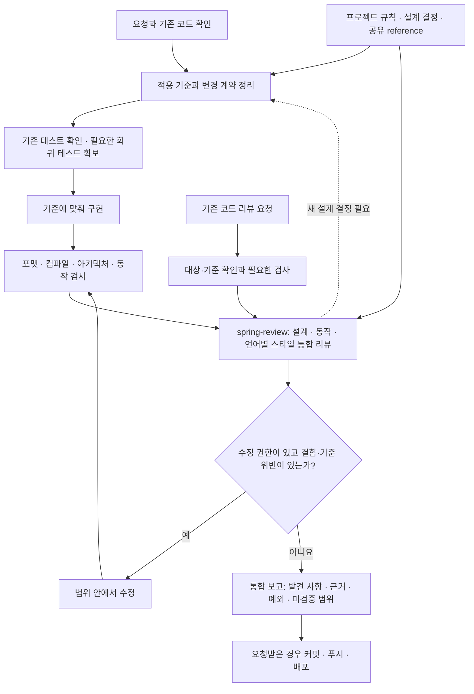

# Spring 구현·리뷰 전체 흐름

`spring-workflow`가 Java·Kotlin·혼용 Spring 프로젝트의 구현과 검사를 마치면 `spring-review`로 연결합니다. 리뷰 결과까지 확인한 뒤 전체 작업을 완료합니다. 기존 코드의 리뷰만 요청하면 `spring-review`에서 바로 시작합니다. 개발과 리뷰는 같은 기준 원문을 읽으며, 프로젝트별 설계 선택을 우선합니다.

구현 완료 후 리뷰를 거쳐 전체 작업을 완료합니다. 리뷰만 요청하면 구현 단계를 생략하고, 수정 권한이 없다면 발견 사항을 보고합니다. 기존 요청으로 결정된 사항을 다시 승인받거나, 작은 변경마다 별도 계획 문서를 만들지는 않습니다.

## 단계별 역할

| 단계 | 담당 스킬·수단 | 확인할 결과 |
| --- | --- | --- |
| 기준과 변경 계약 | `spring-workflow` | 구현할 동작, 소유 모듈·유스케이스, 적용 규칙과 출처, 보존할 동작, 검증 방법 |
| 테스트 확보·구현 | `spring-workflow` | 기존 프로젝트 구조에 맞는 코드와 필요한 동작·회귀 테스트 |
| 자동 검사 | 프로젝트에 구성된 명령 | 실제 검사 범위와 결과. 예: Spotless, 컴파일, Modulith, ArchUnit, 단위·통합 테스트 |
| 리뷰 조정·통합 보고 | `spring-review` | 범위에 맞는 검토를 선택하고 자동 검사와 중복 지적을 정리한 단일 결과 |
| 설계·계약 리뷰 | `spring-design-review` | 합의한 책임·공개 계약·의존 방향의 준수와 런타임 동작 결함 |
| Java 표현 리뷰 | `java-code-style-review` | Java 명명·메서드 구성·타입·가독성 |
| Kotlin 표현 리뷰 | `kotlin-code-style-review` | Kotlin 명명·제어 흐름·타입·상호 운용성 |
| 기존 운영 흐름 확장 리뷰 | 필요할 때 `legacy-feature-extension-review` | 기존 경로 보존, 새 상태·분기, 트랜잭션·외부 부수 효과 |
| 수정·완료 확인 | `spring-workflow` | 발견 사항 처리, 변경에 영향받는 검사 재실행, 남은 예외·위험 보고 |

사용자는 구현에는 `spring-workflow`, 리뷰에는 `spring-review`만 요청하면 됩니다. 하위 리뷰 스킬을 각각 호출할 필요는 없습니다. 설정된 검사가 없으면 [독립 실행형 검사](../../spring-review/references/standalone-checks.md)를 사용하고, 실행하지 못한 범위는 미검증으로 보고합니다. 각 역할이 반드시 별도 에이전트를 뜻하지는 않습니다. 변경에 필요한 리뷰만 수행하며, 같은 코드 상태에서 이미 확인한 검사 결과는 재사용합니다.

## 리뷰만 요청하는 예

> `$spring-review`로 이 프로젝트에서 어제 개발한 API 패키지를 찾아 리뷰해줘. 설계·동작·언어별 스타일을 함께 검토하고, 코드는 수정하지 마.

패키지 경로를 알고 있다면 경로를 지정합니다. 날짜나 기능명만 주어진 경우 Git 이력과 현재 변경으로 범위를 확인하며, 여러 후보가 있으면 필요한 범위만 확인합니다. 해당 패키지와 관련 호출부·쿼리·테스트를 검토하고, 새 문제와 기존 문제를 구분해 한 번에 보고합니다.

## 기준의 원본

| 기준 | 원본 | 개발·리뷰에서의 사용 |
| --- | --- | --- |
| 작업 범위와 동작 | 사용자 요청·기존 계획·인수 조건 | 무엇을 구현하고 어떤 동작을 보존해야 하는지 판단 |
| 프로젝트 설계 선택 | 프로젝트 `AGENTS.md`, 설계 문서·ADR | 모듈 구조, 공개 범위, 컨트롤러 구성 등 해당 프로젝트의 선택 적용 |
| 공통 Spring 설계 | [spring-framework-rules.md](spring-framework-rules.md) | 프로젝트에서 정하지 않은 설계 판단의 기본 기준 |
| Java 표현 | [java-code-style.md](java-code-style.md) | Java 구현과 Java 스타일 리뷰가 같은 원문 사용 |
| Kotlin 표현 | [kotlin-code-style.md](kotlin-code-style.md) | Kotlin 구현과 Kotlin 스타일 리뷰가 같은 원문 사용 |
| 검증 근거와 리뷰 판정 | [jvm-review-checks.md](jvm-review-checks.md) | 자동 검사와 맥락 판단을 구분하고 위반·결함·개선 제안을 분리 |

예를 들어 namya의 컨트롤러·애플리케이션 서비스 통합과 `conversation.spi`는 프로젝트 선택입니다. 다른 Spring 프로젝트에 그대로 강제하지 않습니다. 정적 검사 통과만으로 책임 분리나 동작의 적절성까지 입증되지는 않습니다.
